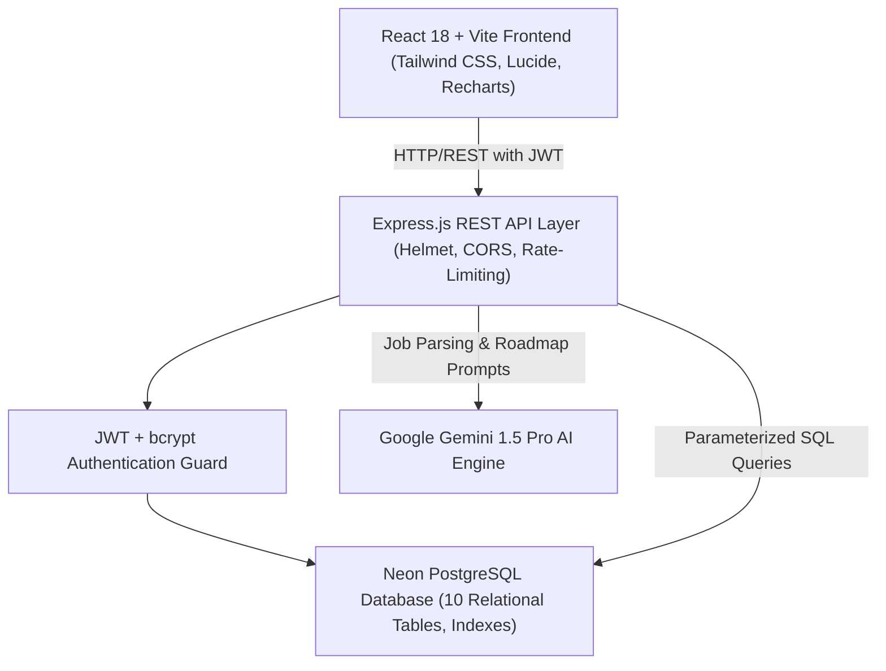
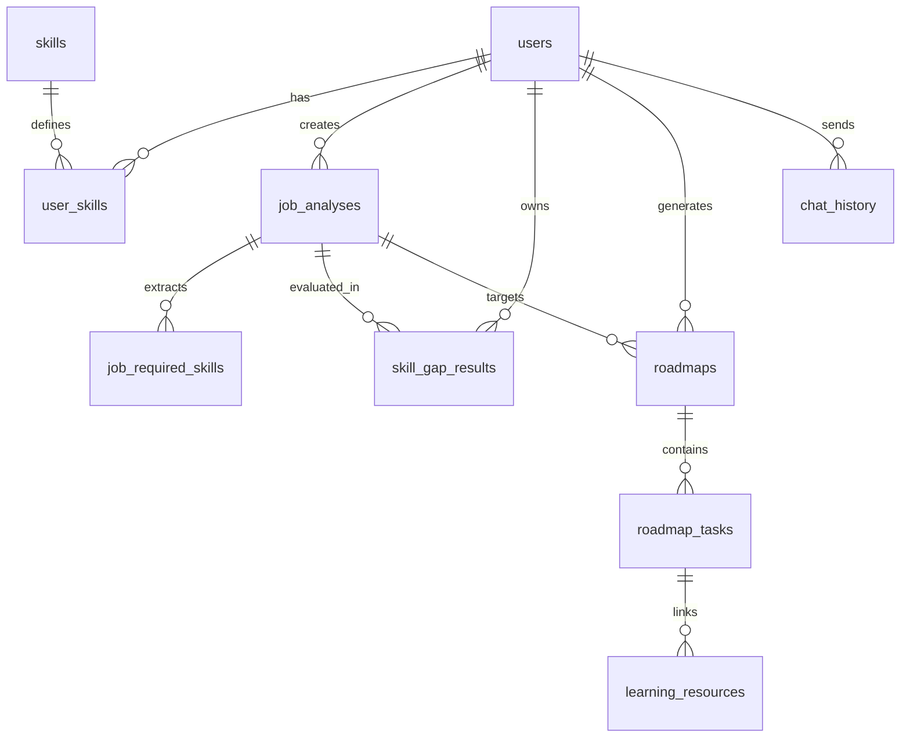

# 🚀 SkillSync AI – AI-Powered Skill Gap Analyzer & Career Learning Planner

SkillSync AI is an intelligent, enterprise-grade career acceleration platform engineered for students, freshers, and job seekers. It analyzes target job descriptions via Google Gemini 1.5 Pro, compares competencies against verified user profiles using deterministic mathematical logic, calculates objective readiness percentages, and generates actionable multi-week learning roadmaps backed by an AI career assistant.

---

## 🏗️ System Architecture



---

## 🗄️ Relational Database Architecture (PostgreSQL)

The database schema is normalized into 10 relational tables with primary keys (`UUID`), foreign keys with cascading deletions, performance B-tree indexes, and JSONB fields for AI results:



### Table Definitions:
1. `users`: Stores user accounts, bcrypt hashed passwords, bio, title, and social links.
2. `skills`: Master catalog of programming languages, frameworks, databases, and DevOps tools.
3. `user_skills`: User's specific skills with verified proficiency (`beginner`, `intermediate`, `advanced`) and experience years. Unique constraint on `(user_id, skill_id)`.
4. `job_analyses`: Job postings uploaded as PDF or text, containing extracted JSON analysis.
5. `job_required_skills`: Individual skills extracted from postings, marked as `required` or `preferred` with importance tiers.
6. `skill_gap_results`: Matched, weak, and missing skills with deterministic match & readiness scores.
7. `roadmaps`: Personalized multi-week learning plans with duration, total hours, and progress.
8. `roadmap_tasks`: Individual milestones organized by week number with priority and completion status.
9. `learning_resources`: Curated documentation, tutorials, and courses attached to tasks.
10. `chat_history`: Historical AI chatbot conversation context.

---

## ⚡ Strict Tech Stack

- **Frontend**: React 18, Vite, JavaScript (Strictly No TypeScript), Tailwind CSS, React Router DOM v6, Axios, Lucide React, Recharts, React Hot Toast, Framer Motion.
- **Backend**: Node.js, Express.js 5, PostgreSQL (`pg` pool with SSL), JWT, bcryptjs, Multer, pdf-parse, Google Gemini 1.5 Pro (`@google/generative-ai`), Helmet, express-rate-limit.
- **Database**: Neon Cloud PostgreSQL (Serverless connection pooler).

---

## 🔒 Security & Code Standards

- **Password Security**: Passwords hashed with `bcryptjs` using 12 salt rounds; never stored in plaintext.
- **JWT Protection**: Tokens signed with secret keys, verified in Express middleware, and auto-attached via Axios interceptors.
- **SQL Injection Prevention**: 100% of database interactions use parameterized SQL statements (`$1, $2`).
- **File Upload Protection**: Multer configured with memory storage, strict `application/pdf` MIME filter, and 5MB payload limit.
- **API Defense**: `helmet` headers, strict `cors` origins, and rate limiters protecting against brute-force attacks.
- **Deterministic Match Scoring**: Match percentages and readiness scores are computed by server-side algorithms (70% required weight, 30% preferred weight, weak skill penalties), never hallucinated by LLMs.

---

## 🏃 Local Setup Instructions

### Prerequisites:
- Node.js (v18+)
- npm (v9+)
- PostgreSQL or Neon Database URL

### 1. Backend Server Setup
```bash
cd skillsync-ai/server
npm install
node server.js
```
The server will automatically connect to Neon PostgreSQL, verify table schema, and start on `http://localhost:5000`.

### 2. Frontend Client Setup
```bash
cd skillsync-ai/client
npm install
npm run dev
```
Open `http://localhost:5173` in your browser.

---

## 🔑 Pre-Configured Demo Account

For rapid evaluation and project presentation:
- **Email**: `alex.developer@skillsync.ai`
- **Password**: `password123`
*(Or click "Auto-fill Demo Credentials" directly on the Login page)*

---

## 📡 API Endpoint Reference

| Method | Endpoint | Description | Auth Required |
|---|---|---|---|
| `POST` | `/api/auth/register` | Register new user account | No |
| `POST` | `/api/auth/login` | Authenticate and obtain JWT | No |
| `GET` | `/api/auth/profile` | Retrieve user profile | Yes |
| `PUT` | `/api/auth/profile` | Update user profile and links | Yes |
| `GET` | `/api/skills` | List master skills | No |
| `GET` | `/api/skills/user` | Get authenticated user's skills | Yes |
| `POST` | `/api/skills/user` | Add skill to profile | Yes |
| `PUT` | `/api/skills/user/:id` | Update skill proficiency | Yes |
| `DELETE` | `/api/skills/user/:id` | Remove skill from profile | Yes |
| `POST` | `/api/jobs/analyze` | Analyze job description (Text or PDF) | Yes |
| `GET` | `/api/jobs` | Get user's saved job analyses | Yes |
| `GET` | `/api/jobs/:id` | Get single job analysis details | Yes |
| `POST` | `/api/skill-gap/:jobId` | Calculate deterministic skill gap | Yes |
| `GET` | `/api/skill-gap/:jobId` | Fetch calculated skill gap results | Yes |
| `POST` | `/api/roadmaps/generate` | Synthesize AI learning roadmap | Yes |
| `GET` | `/api/roadmaps` | List user roadmaps | Yes |
| `GET` | `/api/roadmaps/:id` | Get curriculum tasks and resources | Yes |
| `PUT` | `/api/roadmaps/tasks/:id` | Toggle task completion | Yes |
| `POST` | `/api/ai/chat` | Chat with context-aware AI assistant | Yes |
| `GET` | `/api/dashboard/stats` | Executive KPI stats and activity | Yes |
| `GET` | `/api/dashboard/progress` | Learning velocity and readiness trends | Yes |

---

## 📦 Deployment Guide

1. **Database**: Hosted on [Neon](https://neon.tech) PostgreSQL with connection pooling enabled.
2. **Backend**: Deploy `skillsync-ai/server` to Render, Railway, or AWS EC2 with environment variables from `.env`.
3. **Frontend**: Deploy `skillsync-ai/client` to Vercel or Netlify with `VITE_API_URL` pointing to your deployed backend.
